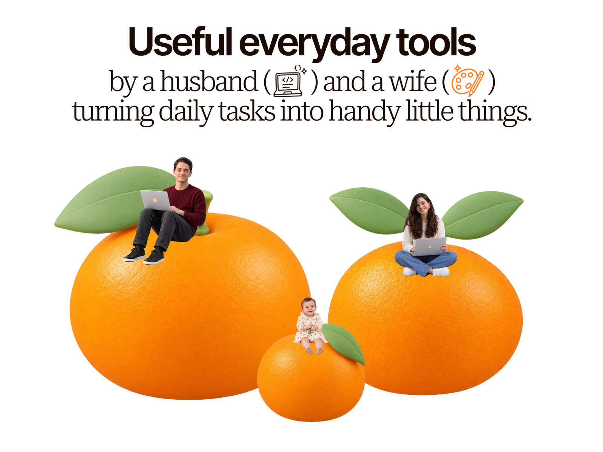

  <picture>
    <source media="(prefers-color-scheme: dark)" srcset="assets/hero-dark.webp">
    
  </picture>

  Hi, we're Sepi and Nima. 
  We make small tools for everyday things at our kitchen table in Canada.

 

## Tools

<table>
  <tr>
    <td valign="top"></td>
    <td valign="top">
      <b><a href="https://github.com/tangistudio/TangiTweak">Tangi Tweak</a></b> &nbsp;Alpha · Chrome and Firefox 
      Make any website work your way. 
      Block, redirect or rewrite what a page loads with a small script. 
      <a href="https://github.com/tangistudio/TangiTweak/releases">Download</a> · <a href="https://github.com/tangistudio/TangiTweak">Source</a> 
      
    </td>
  </tr>
  <tr>
    <td valign="top"></td>
    <td valign="top">
      <b>Tangi Voice</b> &nbsp;Coming soon · macOS 
      Never re-record yourself again. 
      Paste a script and hear it in your own voice. 
      Not public yet
    </td>
  </tr>
  <tr>
    <td valign="top" align="center"></td>
    <td valign="top">
      <b>Next on the kitchen table</b> 
      More small tools are on the way. 
      Follow us here to see them first.
    </td>
  </tr>
</table>

 

## Open source

Our tools are open source. 
Found a bug or have an idea? Open an issue on the tool's repo.

 

   
  Do what you can, with what you have, where you are.

